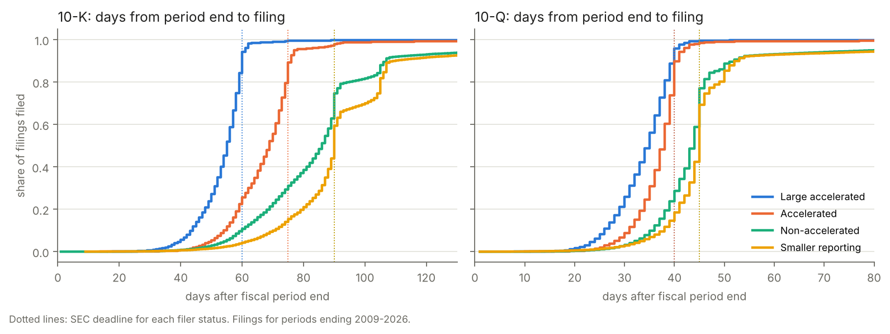
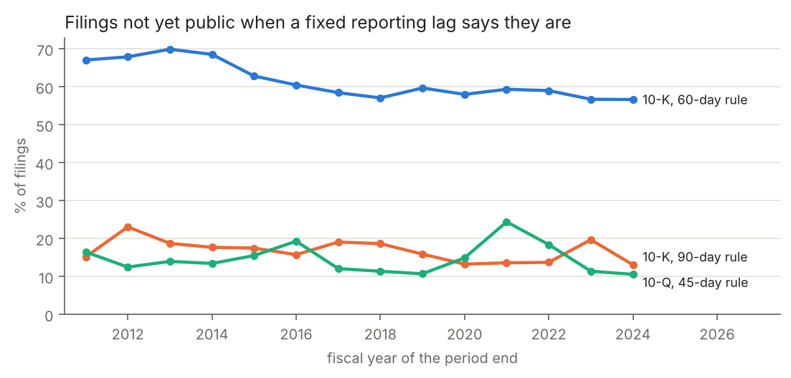
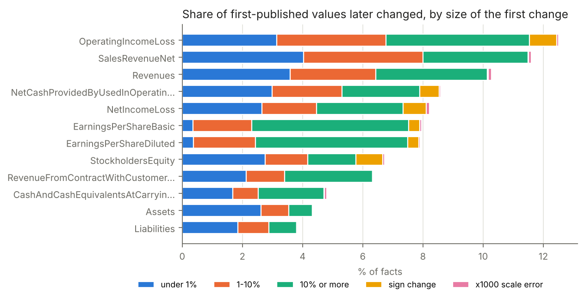
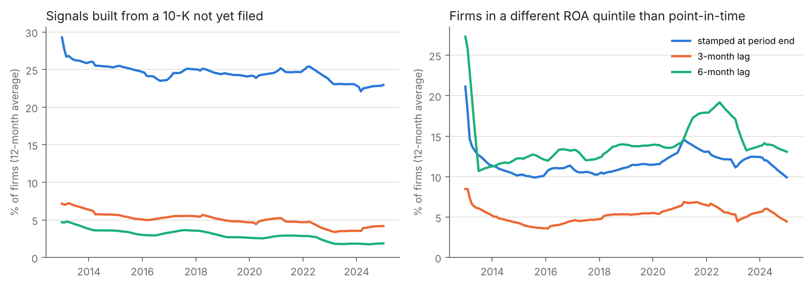

# pit-fundamentals

[](https://github.com/Pearmaleka/pit-fundamentals/actions/workflows/ci.yml)

A point-in-time store of US company fundamentals built from the SEC's
[Financial Statement Data Sets](https://www.sec.gov/data-research/sec-markets-data/financial-statement-data-sets)
(every XBRL number in every 10-K and 10-Q, 2009 Q2 to 2026 Q3), and three measurements of what
goes wrong when a backtest ignores *when* a number became known.

Most fundamentals databases store one value per company and period: the latest one, dated by the
period it describes. That value was not public on the period end date, and often it is not the
value that was first published. This repository keeps every reported version of every number
with the EDGAR acceptance time of the filing that contained it, and measures the size of both
problems.

## Data

| | |
|---|---|
| Quarterly archives | 70 (2009q2 to 2026q3) |
| Reported numbers (`num.txt` rows) | 189 million |
| Filings (`sub.txt` rows) | 440 thousand, from 17 thousand companies |
| Point-in-time store | 87 million consolidated US-GAAP facts, 1.2 GB of Parquet |

The store (`pitfund.store`) keeps entity-level values only (no segment breakdowns, no
company-specific tags). `as_of()` returns, for any (company, tag, period, date) the value in the
latest filing accepted before that date, with the filing's accession number.

The SEC files are tab-separated without quoting. From 2022 Q4 on, 329 rows contain tab characters
inside the `segments` field and break standard CSV readers. `scripts/to_parquet.py` reads each
line whole, puts the surplus fields back into `segments`, and checks the row count of every
output file against the line count of the source.

## Results

Periods ending 2011–2024 unless stated otherwise. Earlier years are thin because small companies
started filing XBRL in mid-2011; later years have not had time for late filings and revisions.

### 1. Publication lag



| Filer status | 10-K median lag (days) | 10-K after deadline | 10-Q median lag | 10-Q after deadline |
|---|---:|---:|---:|---:|
| Large accelerated (deadline 60 / 40 days) | 55 | 2.7% | 35 | 2.5% |
| Accelerated (75 / 40) | 69 | 5.9% | 38 | 5.1% |
| Non-accelerated (90 / 45) | 86 | 22.1% | 44 | 17.1% |
| Smaller reporting (90 / 45) | 90 | 35.6% | 45 | 25.4% |

All periods 2009–2026, 388 thousand original 10-K and 10-Q filings. A filing that was due on a
weekend is due the next Monday. Holidays are ignored, so a few filings counted one day late
were on time. Many of the late small filers used the 15-day (10-K) or 5-day (10-Q) extension of
Form 12b-25; beyond the extension, 14.6% of smaller-reporting 10-Ks were still late.

What this means for a fixed reporting-lag rule:



| Rule | Filings not yet public when the rule says they are |
|---|---:|
| 10-K known 60 days after fiscal year end | 61.8% |
| 10-K known 90 days after fiscal year end | 16.9% |
| 10-K known 120 days after fiscal year end | 4.1% |
| 10-Q known 45 days after quarter end | 14.7% |

### 2. Revisions of first-published numbers

For each fact (company, tag, period, duration) first published in the 10-K or 10-Q for that
period, every later filing that repeats it (next year's comparative columns, amendments) is a
later version. 3.9 million facts across 12 key tags, first published 2009–2026:



| Tag | Facts | Changed later | Changed by 10% or more, sign, or 1000x |
|---|---:|---:|---:|
| NetIncomeLoss | 566,296 | 8.2% | 3.7% |
| Revenues | 224,575 | 10.3% | 3.8% |
| OperatingIncomeLoss | 454,527 | 12.5% | 5.8% |
| EarningsPerShareDiluted | 368,530 | 7.9% | 5.5% |
| NetCashProvidedByUsedInOperatingActivities | 342,368 | 8.6% | 3.3% |
| Assets | 381,703 | 4.4% | 0.8% |
| StockholdersEquity | 350,565 | 6.7% | 2.5% |

Across all 12 tags 7.7% of first-published values were later changed and 3.5% changed by 10% or
more, changed sign, or were off by a factor of 1,000. Only 9.9% of the changes arrived through an
amendment (10-K/A, 10-Q/A); the rest appeared silently in the comparative columns of the next
regular filing, typically a year later. Not every change is an error: reclassifications,
discontinued operations and stock splits (most of the EPS changes) also rewrite earlier numbers.
A backtest needs the first version in every case, because that is what was known.

### 3. Look-ahead in a cross-sectional signal

Signal: return on assets (fiscal-year net income / year-end total assets) from annual reports.
At every month end from 2012 to 2024 the cross-section is built four ways:

* **point-in-time**: latest fiscal year whose 10-K had been accepted, with the values as filed then;
* **stamped at period end**: latest fiscal year that has ended, with today's values;
* **3-month lag** and **6-month lag**: latest fiscal year that ended at least 3 or 6 months
  earlier, with today's values.



| Shortcut | Firms using a 10-K not yet filed | Same year, different value | Different ROA quintile from point-in-time | Rank correlation |
|---|---:|---:|---:|---:|
| Stamped at period end | 24.8% | 10.0% | 12.1% | 0.929 |
| 3-month lag | 5.1% | 11.8% | 5.4% | 0.966 |
| 6-month lag | 3.0% | 8.4% | 14.8% | 0.918 |

Averages over 156 month ends; about 5,600 firms a month. The 3-month rule is the closest, but at
the end of March it still uses an unfiled 10-K for 13% of firms, and over all months 8.4% of its
extreme (top or bottom) quintile assignments do not hold up point-in-time. The 6-month rule rarely looks
ahead but is stale: in 29% of cases it uses an older fiscal year than the one already public,
which moves more firms between quintiles than the look-ahead of the 3-month rule. About 1 in 10
firms has a different ROA under every shortcut simply because today's database holds revised
numbers.

## Limits

* **Availability is the 10-K/10-Q acceptance time.** Most companies announce earnings in a press
  release (Form 8-K) days or weeks earlier, and those numbers are not in this data set. "Not yet
  filed" therefore overstates what the market did not know about income figures; it does not
  overstate it for numbers that appear only in the filing.
* No prices, so these are differences in classification, not in returns.
* Only standard US-GAAP tags at entity level. A company that switches tags (for example from
  `SalesRevenueNet` to `RevenueFromContractWithCustomerExcludingAssessedTax` under ASC 606)
  starts a new series; such switches are not counted as revisions.
* Filer status is as stated in each filing; federal holidays and Form 12b-25 notices are not
  in the data.
* Foreign private issuers (20-F, 40-F) and IFRS filers are excluded.

## Reproduce

About 5.4 GB of downloads and 3.8 GB of Parquet. Every step can be split by a time budget.

```bash
pip install -e ".[figures]"
python scripts/download_sec_fsds.py <root>/raw/sec_fsds   # set USER_AGENT first (SEC policy)
python scripts/to_parquet.py <root>                       # zips -> Parquet, logs repaired rows
python scripts/build_store.py <root>                      # point-in-time fact store
python scripts/run_all.py <root>                          # CSVs in <root>/results
python scripts/make_report.py <root>/results              # headline.json and the figures
```

The CSVs and `results/headline.json` from the run above are in [`results/`](results). Tests use
small synthetic filings (`pytest`).

## Layout

```
src/pitfund/store.py      point-in-time fact store and as_of()
src/pitfund/filings.py    filing calendar, SEC deadlines, fixed-lag exposure
src/pitfund/revisions.py  first-published vs later versions
src/pitfund/lookahead.py  point-in-time vs naive cross-sections
scripts/                  download, conversion, runs, report
```

## License

MIT. The SEC data are public.
